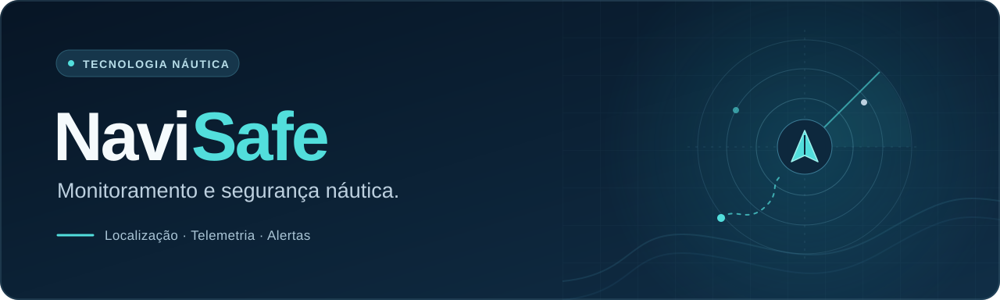

  

  Monitoramento náutico com localização, telemetria e alertas. 
  Conectando embarcações, devices e pessoas.

<h2 align="center">Conheça nossos projetos</h2>

  <a href="https://github.com/NavisafeApp/backend"> <strong>Backend</strong></a>
  &nbsp;·&nbsp;
  <a href="https://github.com/NavisafeApp/mobile"> <strong>Mobile</strong></a>
  &nbsp;·&nbsp;
  <a href="https://github.com/NavisafeApp/docs"> <strong>Docs</strong></a>
  &nbsp;·&nbsp;
  <a href="https://github.com/NavisafeApp/navisafe-legado"> <strong>Legado</strong></a>

## Um ecossistema conectado

Cada repositório tem um papel na construção do produto.

| | Projeto | O que você encontra |
| :---: | --- | --- |
|  | **[Backend](https://github.com/NavisafeApp/backend)** | API e processamento de telemetria. NestJS · TypeScript · PostgreSQL |
|  | **[Mobile](https://github.com/NavisafeApp/mobile)** | Novo aplicativo para Android e iOS. Previsto em Flutter · Dart |
|  | **[Documentação](https://github.com/NavisafeApp/docs)** | Escopo, arquitetura, diagramas e referências técnicas. |
|  | **[Legado](https://github.com/NavisafeApp/navisafe-legado)** | Sistemas anteriores, preservados para consulta. |

> A nova fase está em desenvolvimento. O legado é uma referência histórica, não a base do novo aplicativo ou backend.

## Da embarcação ao aplicativo

A arquitetura da nova fase conecta os devices existentes, via MQTT, ao backend e ao aplicativo mobile. Os detalhes de execução e desenvolvimento ficam no README de cada projeto.

---

  NaviSafe · Monitoramento e segurança náutica

